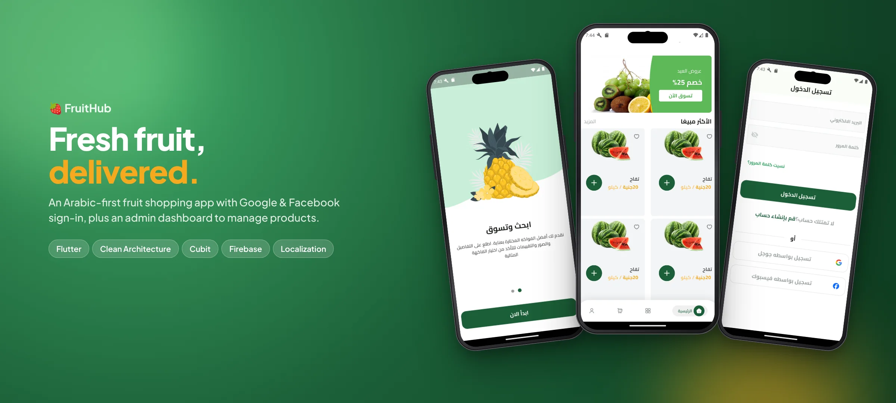
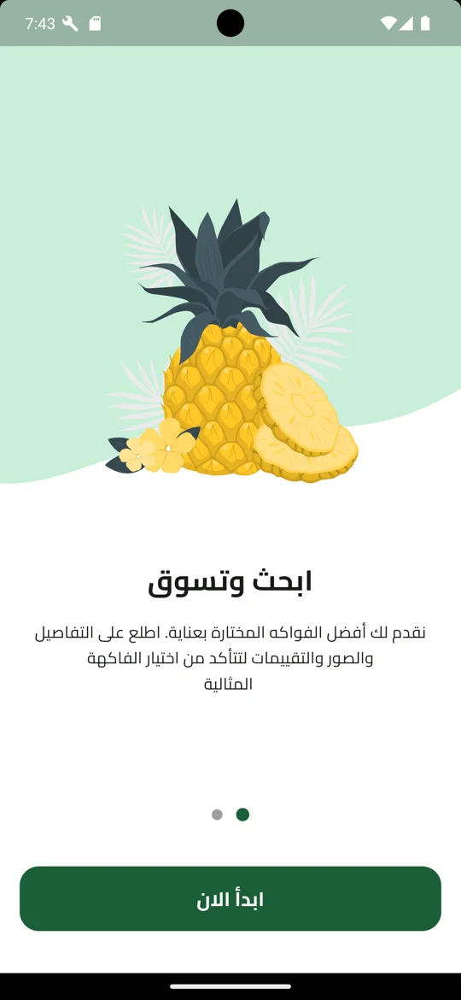
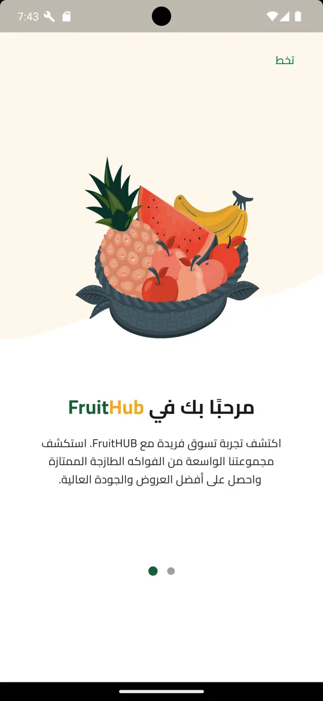

<h1 align="center">🍓 FruitHub</h1>

<p align="center">
  An Arabic-first fruit shopping app built with <b>Flutter</b> and <b>Firebase</b>,
  with a separate <a href="https://github.com/youssef-hossam/fruit_hub_dash_board">admin dashboard</a> to manage products.
</p>

<p align="center">
  
  
  
  
</p>

<p align="center">
  
</p>

## 📱 Screens

| Splash | Onboarding | Onboarding |
|:-:|:-:|:-:|
|  |  |  |

| Login | Google sign-in | Home |
|:-:|:-:|:-:|
|  |  |  |

## ✨ Features

- 🔐 **Authentication** with Firebase: email & password, **Google** and **Facebook** sign-in.
- 👤 User data saved in **Cloud Firestore** and cached locally with `shared_preferences`.
- 🏠 Home with offers, best-selling products and a bottom navigation bar.
- 🌍 **Localization (Arabic / English)** with `intl`.
- ✨ Splash & onboarding, loading overlays and clear error messages.

## 🏗️ How it's built

```
lib/
├── core/            # services, repos, errors, entities, widgets, utils
└── features/
    ├── splash/
    ├── on_boarding/
    ├── auth/        # data · domain · presentation
    └── home/        # domain · presentation
```

- **Architecture:** Clean Architecture (data / domain / presentation) with the repository pattern.
- **State management:** Cubit (`flutter_bloc`).
- **Error handling:** `dartz` — `Either<Failure, T>`.
- **DI:** `get_it`.
- **Backend:** Firebase Auth + Cloud Firestore.

## 🚀 Run it

```bash
flutter pub get
flutter run
```

> Uses the project's Firebase config. To use your own Firebase project, run `flutterfire configure`.

---

<p align="center">Made with ❤️ by <a href="https://github.com/youssef-hossam">Youssef Hadwa</a></p>
