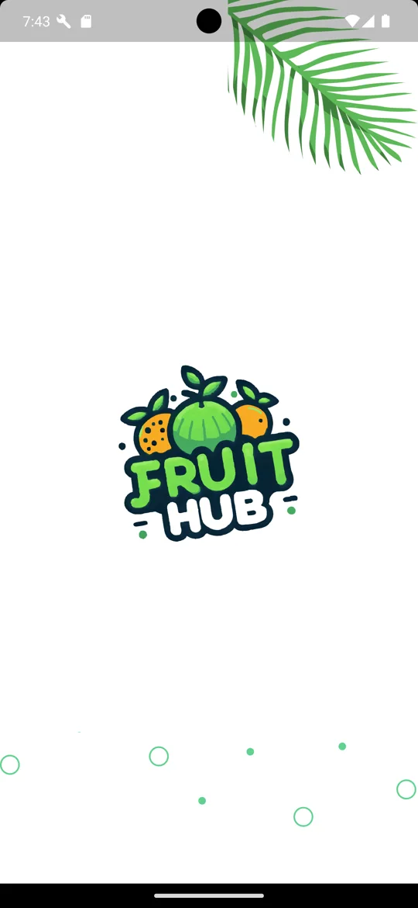
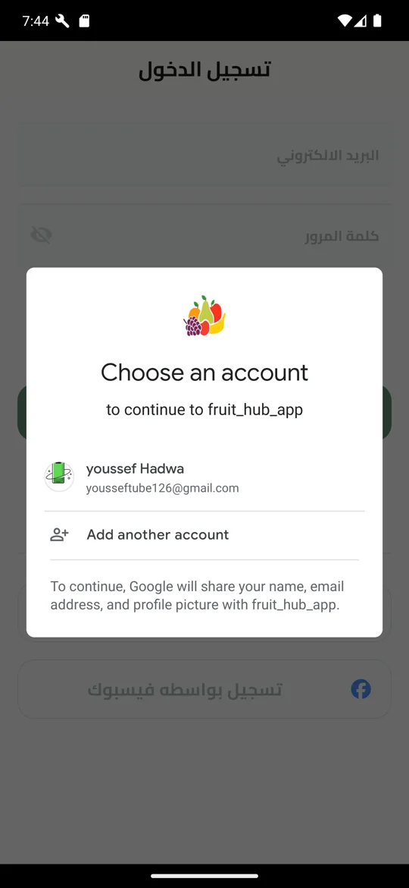
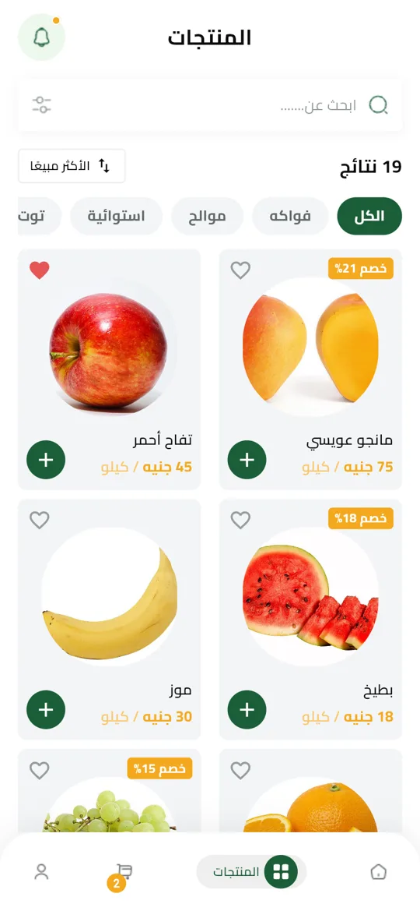
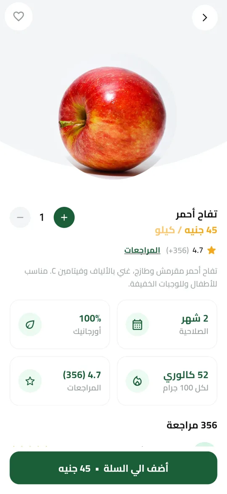
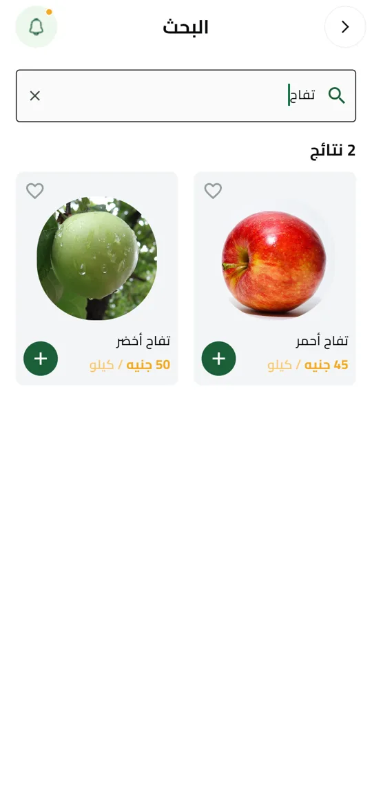
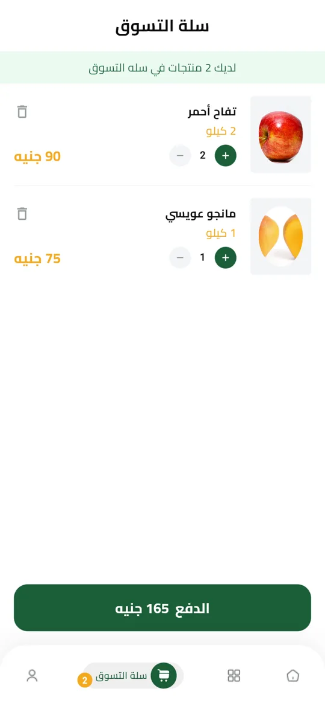

<h1 align="center">🍓 FruitHub</h1>

<p align="center">
  A complete, Arabic-first fruit store built with <b>Flutter</b> and <b>Firebase</b> —
  browse, search, add to cart, check out and track your orders.<br/>
  Products are managed from the <a href="https://github.com/youssef-hossam/fruit_hub_dash_board">admin dashboard</a>.
</p>

<p align="center">
  
  
  
  
  
</p>

<p align="center">
  
</p>

## ✨ Features

- 🔐 **Authentication** with Firebase — email & password, **Google** and **Facebook** sign-in, and logout from every provider.
- 🏠 **Home** — offers carousel, best-selling products and a live cart badge on the bottom bar.
- 🍎 **Products** from **Cloud Firestore** — categories, sorting (best selling, price, rating) and instant **search** in Arabic or English.
- 📄 **Product details** — quantity picker, discount, shelf life, organic, calories and customer reviews.
- 🛒 **Cart** saved on the device — change quantities, swipe to delete, live total.
- 💳 **3-step checkout** — shipping method, delivery address (validated) and order review; free delivery over 300 EGP.
- 📦 **My orders** saved in Firestore, with a status timeline (pending → preparing → on the way → delivered).
- ❤️ **Favorites**, 🔔 **notifications** and a **profile** screen.
- 🌍 **Localization (Arabic / English)** — switch language from the profile, the whole UI flips direction.

## 📱 Screens

| Splash | Onboarding | Login | Social sign-in |
|:-:|:-:|:-:|:-:|
|  |  |  |  |

| Home | Products | Product details | Search |
|:-:|:-:|:-:|:-:|
|  |  |  |  |

| Cart | Shipping | Address | Review |
|:-:|:-:|:-:|:-:|
|  |  |  |  |

| Order placed | My orders | Profile | Favorites |
|:-:|:-:|:-:|:-:|
|  |  |  |  |

## 🏗️ How it's built

```
lib/
├── core/
│   ├── cubits/        # products, favorites, locale
│   ├── demo/          # demo data, seeder, in-memory database for demo mode
│   ├── entities/ models/ repos/
│   ├── services/      # Firebase auth, Firestore, get_it, shared prefs
│   └── widgets/       # product card, grids, app bar, quantity stepper…
└── features/
    ├── splash/  on_boarding/  auth/
    ├── home/  products/  product_details/  search/
    ├── cart/  checkout/  orders/
    └── profile/  favorites/  notifications/
```

- **Architecture:** Clean Architecture (data / domain / presentation) with the repository pattern. The app talks to a `DatabaseService` abstraction, so Firestore can be swapped (the demo mode uses an in-memory implementation).
- **State management:** Cubit (`flutter_bloc`) — products, cart, favorites, orders, checkout and language.
- **Error handling:** `dartz` — `Either<Failure, T>`.
- **DI:** `get_it`.
- **Backend:** Firebase Auth + Cloud Firestore (`products`, `users`, `orders`). Security rules are in [`firestore.rules`](firestore.rules).

## 🚀 Run it

```bash
flutter pub get
flutter run
```

- On the first run (debug build), if the `products` collection is empty, the app fills it with **19 demo fruits** (prices, ratings, reviews) and adds a few sample orders for the signed-in user.
- **Demo mode** — runs without Firebase on in-memory data (handy for a quick preview):

```bash
flutter run -d chrome --dart-define=DEMO=true
```

> Uses Flutter **3.16.9** (see `.fvmrc`). Product photos are from Wikimedia Commons — see [`assets/products/CREDITS.md`](assets/products/CREDITS.md).

---

<p align="center">Made with ❤️ by <a href="https://github.com/youssef-hossam">Youssef Hadwa</a></p>
